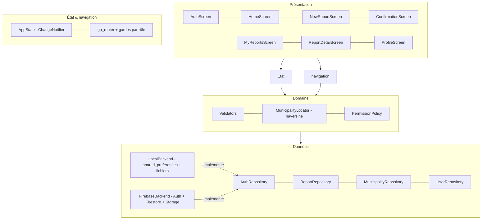
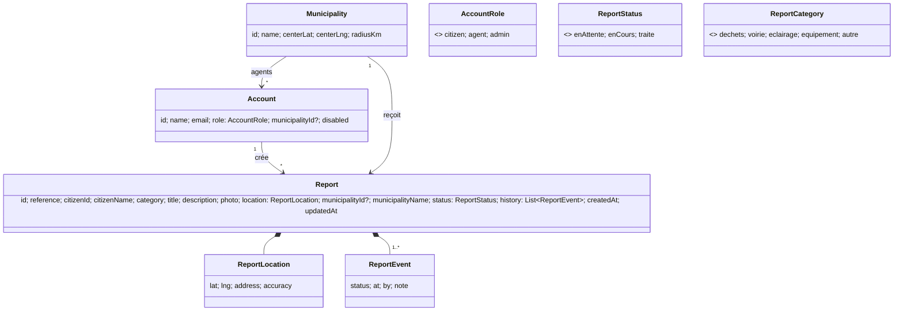
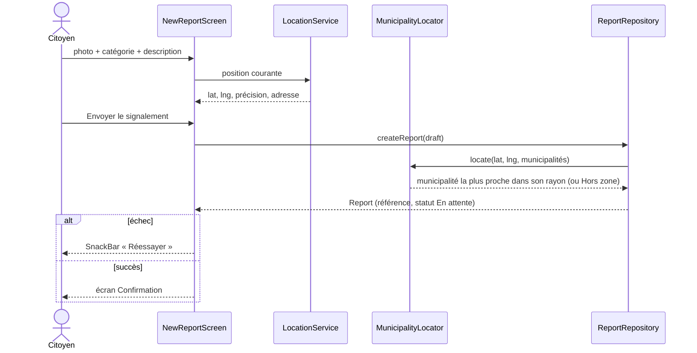
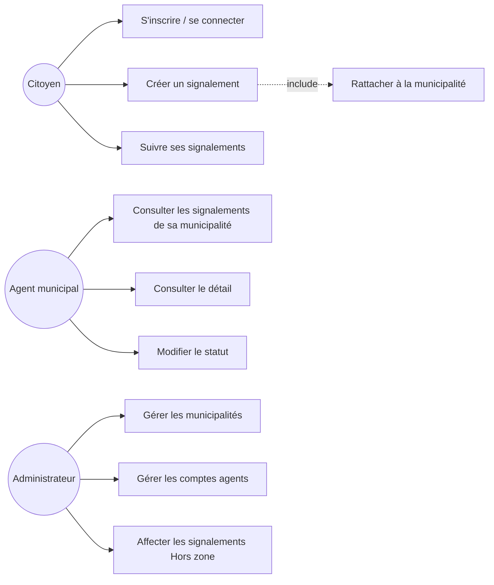
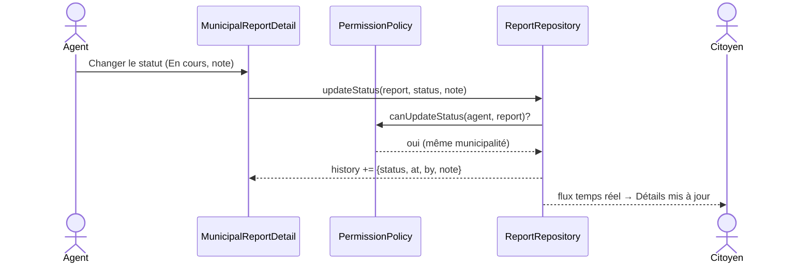
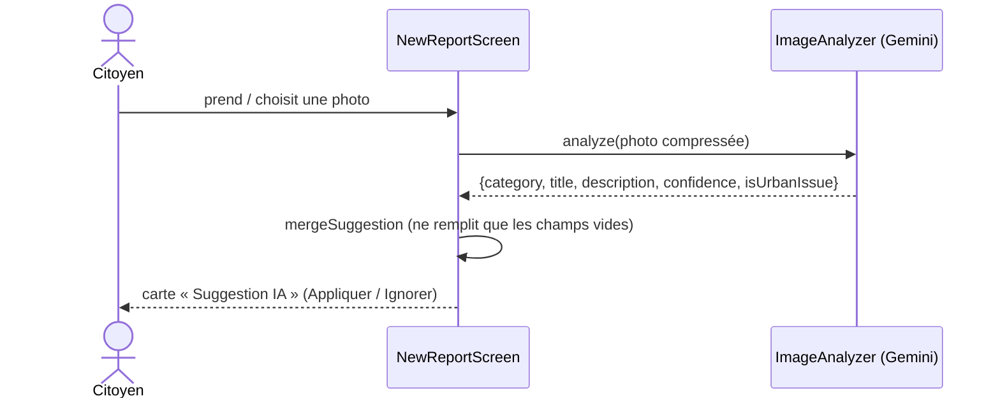

# Reportini — Dossier Scrum (Étapes 3 et 4)

Équipe : Lotfi Naffeti, Aziz Kouki · Encadrante : Mme Sonia Guerbouj · DSI3 ISET Nabeul 2026‑2027
Rôles outillés : planification/Scrum Master assistée par Claude, implémentation assistée par Codex (gpt‑6.2‑sol), revue et tests sur émulateur Android (Pixel 7, API 36).

---

## Release 1 — Sprint 1 : Signalement et suivi citoyen (02/11 → 13/11/2026)

### Sprint Backlog

| ID | User Story | Tâches techniques | SP | État |
|----|-----------|-------------------|----|------|
| US1 | Configurer Flutter + Firebase | Projet Flutter (android, web), thème Civic Modernist, go_router, provider, couche Repository, `LocalBackend` (utilisé en démo) + `FirebaseBackend` (code et règles prêts, projet Firebase pas encore créé), données de démonstration | 3 | ✅ (Firebase à brancher) |
| US2 | Créer un compte / se connecter | Écrans Connexion & Inscription, validateurs (e‑mail, 8 car. + 1 chiffre, confirmation, CGU), session persistante, redirection par rôle | 3 | ✅ |
| US3 | Prendre/choisir une photo | `image_picker` caméra/galerie, compression (1280 px, qualité 70), « Reprendre » | 3 | ✅ |
| US4 | Choisir une catégorie | Puces : Déchets, Voirie, Éclairage, Équipement, Autre anomalie urbaine | 2 | ✅ |
| US5 | Ajouter une description | Titre + description ≤ 250 caractères avec compteur | 1 | ✅ |
| US6 | Obtenir la position GPS | `geolocator`, précision, adresse (`geocoding`), carte OSM, « Modifier » / « Rafraîchir ma position », gestion des refus | 3 | ✅ |
| US7 | Envoyer + être averti en cas d’échec | Envoi avec indicateur, SnackBar « Réessayer », écran Confirmation (référence RPT‑AAAA‑XXXXX copiable) | 5 | ✅ |
| US8 | Consulter mes signalements | Accueil (3 derniers), Mes signalements (filtres + compteurs), Détails (photo, carte, GPS, chronologie), Profil (statistiques, déconnexion) | 3 | ✅ |
| | **Total** | | **23** | **23/23** |

### Conception

**Architecture en couches**

**Diagramme de classes (modèle)**

**Séquence — Envoyer un signalement (US6, US7, US10)**

### Sprint Review (13/11/2026)
- Démo sur émulateur : connexion `citoyen@reportini.tn` → « Signaler un problème » → photo galerie, catégorie Éclairage, titre → position GPS Nabeul détectée et affichée sur la carte → envoi → référence `RPT‑2026‑…` → Détails avec chronologie « Signalement envoyé ».
- Release 1 validée : un citoyen connecté envoie un signalement complet et le retrouve dans sa liste avec son statut.
- Qualité : `flutter analyze` sans problème, 12 tests verts, APK debug généré.

### Rétrospective
| 👍 À garder | 👎 À améliorer | 🎯 Actions |
|-------------|---------------|-----------|
| Couche Repository : l’app fonctionne sans projet Firebase | Adresse affichée en « Plus Code » (FP4P+M94) | Formater l’adresse depuis rue/localité (Sprint 3) |
| Maquettes Stitch suivies fidèlement | Build Android cassé sous Windows (caches Kotlin entre disques C:/D:) | `kotlin.incremental=false` dans `gradle.properties` |
| Tests unitaires sur la logique pure (validateurs, géolocalisation) | Bac à sable de l’agent sans réseau → vérifications faites par la revue | Quality gate exécuté systématiquement avant commit |

---

## Release 2 — Sprint 2 : Traitement municipal (16/11 → 27/11/2026)

### Sprint Backlog

| ID | User Story | Tâches techniques | SP | État |
|----|-----------|-------------------|----|------|
| US9 | Définir les municipalités | CRUD (nom, centre saisi ou choisi sur la carte, rayon), cercle de zone sur la carte, validations, suppression protégée | 3 | ✅ |
| US10 | Routage vers la municipalité | `MunicipalityLocator` sur les municipalités courantes ; « Hors zone » + affectation manuelle par l’admin | 3 | ✅ |
| US11 | Comptes agents | Création (mot de passe temporaire), rattachement, changement de municipalité, activation/désactivation ; app Firebase secondaire pour ne pas déconnecter l’admin | 3 | ✅ |
| US12 | Connexion agent | Même écran Connexion, redirection `/dashboard`, en‑tête nom + municipalité, gardes de routes | 2 | ✅ |
| US13 | Signalements reçus | Liste filtrée par municipalité, KPI, filtres statut/catégorie, recherche, mise à jour en temps réel | 5 | ✅ |
| US14 | Détail d’un signalement | Photo zoomable, citoyen, carte + « Ouvrir dans le GPS », chronologie | 3 | ✅ |
| US15 | Modifier le statut | Dialogue « Changer le statut » + note, ajout à l’historique, visible côté citoyen | 3 | ✅ |
| | **Total** | | **22** | **22/22** |

### Conception

**Cas d’utilisation**

**Matrice des droits (`PermissionPolicy` ↔ `firestore.rules`)**

| Ressource | Citoyen | Agent | Admin |
|-----------|---------|-------|-------|
| `users/{uid}` | lit/modifie le sien (sauf rôle, municipalité) | lit le sien | tout |
| `municipalities` | lecture | lecture | création / modification / suppression |
| `reports` lecture | les siens uniquement | ceux de sa municipalité | tous |
| `reports` création | `citizenId == uid`, statut `en_attente` | — | — |
| `reports` mise à jour | — | statut + historique + `updatedAt` de sa municipalité | tout (dont affectation) |

**Séquence — Changer le statut (US15)**

### Sprint Review (27/11/2026)
- Démo : `agent.nabeul@reportini.tn` voit le signalement envoyé par le citoyen (KPI 4 / 2 / 1 / 1), ouvre le détail, passe le statut à « En cours » avec la note « Équipe envoyée sur place » → l’étape apparaît dans « Suivi d’avancement ». `admin@reportini.tn` voit la vue d’ensemble par municipalité et la catégorie « Hors zone ».
- Release 2 validée : les signalements sont rattachés aux municipalités ; l’agent les consulte et modifie leur statut.
- Qualité : `flutter analyze` sans problème, 20 tests verts, APK debug et build Web générés.

### Rétrospective
| 👍 À garder | 👎 À améliorer | 🎯 Actions |
|-------------|---------------|-----------|
| Politique de droits testée unitairement et reflétée dans les règles Firestore | Vue d’ensemble admin peu fournie en démo | Données de démonstration supplémentaires (Sprint 3) |
| Un seul code pour mobile et tableau de bord Web | « Hors zone » trié au milieu des villes | Toujours l’afficher en dernier |
| Revue sur appareil réel/émulateur avant chaque commit | Règles Firebase non testées sur un vrai projet | Déployer les règles dès la création du projet Firebase |

---

## Sprint 3 — Durcissement et livraison
Formatage d’adresse sans Plus Code, tri « Hors zone », données de démo versionnées, icône de l’application, accessibilité (Semantics, cibles 48 dp), ouverture des paramètres si la localisation est refusée, tests d’intégration de connexion, APK release.

---

## Sprint 4 — Reconnaissance automatique par IA

### Sprint Backlog

| ID | User Story | Tâches techniques | SP | État |
|----|-----------|-------------------|----|------|
| US16 | En tant que citoyen, je veux que l’application reconnaisse le problème sur ma photo afin de remplir mon signalement plus vite. | `ImageAnalyzer` (Gemini par défaut, Grok/OpenAI compatibles), prompt français, réponse JSON contrainte, carte « Suggestion IA » (catégorie, titre, description, confiance), fusion sans écraser les choix du citoyen | 5 | ✅ |
| US17 | En tant que citoyen, je veux être averti si ma photo ne montre pas un problème urbain. | Champ `isUrbanIssue` + avertissement non bloquant | 1 | ✅ |
| US18 | En tant qu’administrateur, je veux configurer la clé API de l’IA. | Écran « Assistant IA » (fournisseur, clé masquée, modèle, test), clé de remplacement dans `ai_keys.dart`, `--dart-define-from-file` | 2 | ✅ |
| US19 | En tant qu’agent, je veux voir la catégorie suggérée par l’IA. | `aiCategory` / `aiConfidence` enregistrés avec le signalement | 1 | ✅ |
| | **Total** | | **9** | **9/9** |

### Conception

Choix du fournisseur : **Google Gemini (Flash)** — offre gratuite sans carte, multimodal natif, sortie JSON validée par un schéma, cohérent avec l’écosystème Google (Flutter, Firebase). Grok reste possible via l’API compatible OpenAI.

### Sprint Review
- Sans clé (valeur `COLLEZ_VOTRE_CLE_API_ICI`) : l’IA est désactivée, le parcours de signalement reste identique, une astuce propose l’activation.
- Avec une clé : la photo est analysée, la catégorie et les champs vides sont pré-remplis ; une clé invalide affiche « Clé API invalide ou non autorisée » sans bloquer l’envoi.
- Qualité : `flutter analyze` sans problème, 42 tests verts (dont 15 pour l’IA), APK et build Web générés.

### Rétrospective
| 👍 À garder | 👎 À améliorer | 🎯 Actions |
|-------------|---------------|-----------|
| IA facultative : aucune dépendance bloquante | Clé API embarquée dans l’app | Passer l’appel IA par une Cloud Function en production |
| Logique de fusion testée unitairement | Gemini renvoie une clé invalide en HTTP 400 | Erreur lue dans le corps de la réponse (corrigé) |
